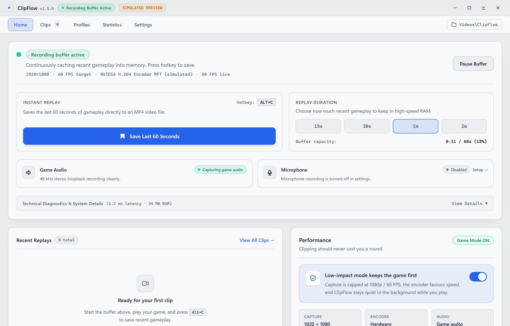

# ClipFlow

ClipFlow is an instant replay and gameplay recording utility for Windows 10 and 11. It records your active display into a rolling memory buffer and saves the last 15 to 120 seconds of gameplay to disk with a single hotkey press.

Built with Rust and Tauri v2, ClipFlow uses native Direct3D 11 desktop duplication and Windows Media Foundation hardware encoders to keep CPU and memory overhead low during gaming sessions.

---



---

## How It Works

1. **Circular Replay Buffer**: Gameplay frames are encoded directly on your GPU and stored in a rolling RAM ring buffer. No intermediate video files are written while you play.
2. **Instant Clip Flush**: Pressing `Alt + C` packages the cached frames into a standard MP4 file in `%USERPROFILE%\Videos\ClipFlow` without interrupting your game or stealing window focus.
3. **Synchronized Audio Capture**: Dual WASAPI streams capture game audio and microphone input with monotonic timestamp synchronization, silence injection, and automatic device-loss recovery.

---

## Core Features

- **Instant Replay**: Keep 15, 30, 60, or 120 seconds of recent gameplay ready to save at any time.
- **Hardware-Accelerated Encoding**: Supports H.264 and HEVC (H.265) through NVIDIA NVENC, AMD AMF, and Intel QuickSync.
- **Lossless Clip Trimming**: Cut start and end points using keyframe stream-copy to export clips without re-encoding.
- **Split at Playhead**: Split a recorded clip into two separate files with one click.
- **Per-Game Capture Profiles**: Assign resolution, frame rate, and bitrate presets to specific game executables with automatic foreground detection.
- **Game Tagging & Folders**: Clips are automatically labeled with the active game title and can be sorted into dedicated subdirectories.
- **Clip Library**: Browse recordings with inline hover previews, audio presence badges, tag filtering, and batch management.
- **On-Screen Recording HUD**: Optional lightweight, click-through overlay showing recording status and buffer elapsed time.
- **Privacy Gate**: Automatically pauses recording when sensitive applications, password prompts, or UAC elevation dialogues appear.
- **GIF Export**: Export short highlights directly to animated GIF with per-frame palette generation.
- **Zero Telemetry**: No accounts, no background tracking services, and no cloud uploads. All video and metadata remain on your local machine.

---

## Default Keyboard Shortcuts

| Shortcut | Action | Description |
| :--- | :--- | :--- |
| `Alt + C` | **Save Replay** | Writes the current rolling buffer to an MP4 clip on disk |
| `Alt + Shift + C` | **Arm / Disarm** | Starts or pauses the background recording buffer |

Hotkeys can be customized at any time in **Settings → Keyboard Shortcuts**.

---

## Quick Start

### 1. Download

Download the latest version from the [Releases](https://github.com/drexjgobgt/ClipFlow-Dev/releases) page:

- **Installer (`.exe` / `.msi`)**: Standard Windows installer with desktop shortcuts and automatic update support.
- **Portable (`.exe`)**: Self-contained executable requiring no installation.

### 2. First Run

1. Launch ClipFlow. The status bar will indicate **Ready to record** or **Recording buffer active**.
2. Start your game.
3. When something memorable happens, press `Alt + C`. A system notification will confirm the saved clip.
4. Access your recordings in the **Clips** tab or directly in `%USERPROFILE%\Videos\ClipFlow`.

---

## System Requirements

- **Operating System**: Windows 10 (version 1809 or newer) or Windows 11 (64-bit).
- **Graphics Card**: DirectX 11.1 compatible GPU with hardware encoding support:
  - NVIDIA GeForce GTX 600 series or newer (NVENC)
  - AMD Radeon HD 7000 series or newer (AMF)
  - Intel HD Graphics 4200 or newer (QuickSync)
- **Memory**: Minimum 4 GB RAM (the circular buffer typically consumes 80–120 MB for a 60-second 1080p replay).
- **Storage**: Fast storage (SSD recommended) for saving MP4 clips.

---

## Building from Source

### Prerequisites

- [Rust](https://www.rust-lang.org/tools/install) (1.75 or later)
- [Node.js](https://nodejs.org/) (v18 or later)
- Visual Studio C++ Build Tools with the Windows 10/11 SDK

### Build Steps

```powershell
# Clone the repository
git clone https://github.com/drexjgobgt/ClipFlow-Dev.git
cd ClipFlow

# Install frontend dependencies
npm install

# Run the development environment
npm run tauri dev

# Build production executable and installer
npm run tauri build
```

Compiled application binaries and installer bundles are generated in `src-tauri/target/release/bundle/`.

---

## License

This project is licensed under the [MIT License](LICENSE).

Maintained by [drexjgobgt](https://github.com/drexjgobgt). Originally developed by [jaimitus](https://github.com/jaimitus).
